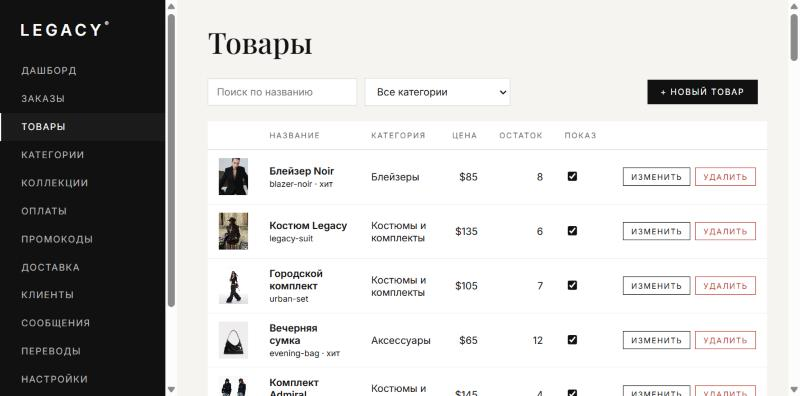

# LEGACY — интернет-магазин минималистичной одежды

Витрина с каталогом на трёх языках (RU / EN / UZ), корзиной и оформлением заказа, админ-панелью, оплатой картой через Stripe и уведомлениями в Telegram. Сайт работает без сборки и фреймворков: HTML, CSS и JavaScript-модули плюс небольшой Node.js-сервер для заказов и админки.

| Главная | Страница товара |
|---|---|
|  |  |

| Каталог в тёмной теме | Админ-панель |
|---|---|
|  |  |

## Возможности

**Витрина**
- Каталог из 43 товаров: поиск с подсказками, фильтры по категории, коллекции и цене, сортировка, состояние фильтров в адресе страницы.
- Коллекции (Essentials, Tailoring, Urban, Evening, Capsule FW), блоки «Новинки» и «Популярное», бейджи «Новинка», «Хит», «Осталось мало».
- Страница товара: выбор размера и цвета, таблица размеров, фото на весь экран, похожие и недавно просмотренные, хлебные крошки, избранное, быстрый просмотр на карточках.
- Три языка и две валюты (сум / доллар), светлая и тёмная тема, быстрый поиск `Ctrl+K`.

**Покупка**
- Корзина с мини-корзиной, промокоды, доставка (самовывоз, курьер, по Узбекистану) с прогрессом до бесплатной доставки.
- Оформление в четыре шага с проверкой полей и маской телефона `+998`, оплата при получении или онлайн через Stripe.
- Страница заказа, история заказов, повторная попытка оплаты.

**Магазин**
- Админ-панель: дашборд, заказы (статусы, заметки, экспорт CSV), товары с загрузкой фото и остатками по размерам, категории, коллекции, оплаты, промокоды, доставка, клиенты, сообщения, переводы, настройки, журнал действий.
- Заказы и сообщения из формы приходят в Telegram; сервер сам пересчитывает цены и проверяет наличие.

**Качество**
- PWA: устанавливается как приложение, открывает уже просмотренные страницы и каталог без интернета.
- SEO: описания страниц, Open Graph, структурированные данные (товар, хлебные крошки, организация), динамические `sitemap.xml` и `robots.txt`.
- Доступность: ссылка «к содержимому», фокус и ловушка фокуса в окнах, управление списками с клавиатуры, aria-атрибуты, уважение настройки «уменьшить анимацию».

## Как запустить

Нужен [Node.js](https://nodejs.org) 20 или новее. Установка зависимостей не требуется.

```
node dev-server.js            # сайт и серверные функции на http://localhost:8000
node dev-server.js --mock     # то же, но сообщения в Telegram печатаются в консоль
node dev-server.js --port=8001
```

Без Node сайт тоже откроется (`python -m http.server` или просто файл `index.html`): будут работать витрина, корзина и избранное по исходным данным, но без заказов на сервере, админки, Telegram и Stripe.

### Переменные окружения

Скопируйте `.env.example` в `.env` и заполните нужное. Файл `.env` в `.gitignore`, его нельзя коммитить и показывать.

| Переменная | Для чего |
|---|---|
| `TELEGRAM_BOT_TOKEN`, `TELEGRAM_CHAT_ID` | уведомления о заказах и сообщениях |
| `ADMIN_LOGIN`, `ADMIN_PASSWORD_HASH`, `SESSION_SECRET` | вход в админку (получить: `node make-admin.js "пароль"`) |
| `STRIPE_SECRET_KEY` | онлайн-оплата Stripe (только тестовый ключ `sk_test_…`) |

## Telegram

Новые заказы и сообщения из формы «Обратная связь» приходят владельцу в Telegram. Токен бота лежит только на сервере и в браузер не попадает.

1. В Telegram откройте [@BotFather](https://t.me/BotFather), отправьте `/newbot` и получите **токен**.
2. Откройте своего бота и нажмите **Start** (бот не напишет вам, пока вы не напишете ему первым).
3. Узнайте **chat_id**: напишите боту сообщение и откройте `https://api.telegram.org/bot<ТОКЕН>/getUpdates`, нужное число лежит в `"chat":{"id": …}`.
4. Впишите токен и chat_id в `.env`.

Если сообщения не приходят, запустите `node check-telegram.js`: она проверит токен, покажет чаты, которые писали боту, и сверит их с `TELEGRAM_CHAT_ID`. Частая причина «chat not found»: вы не нажали Start у бота.

Заказ не теряется, если сервер или сеть недоступны: он сохраняется в браузере покупателя и отправляется повторно (при загрузке страницы, при возвращении интернета и по кнопке «Отправить сейчас» на странице заказа).

## Админ-панель

Адрес: `/admin.html`. Чтобы задать пароль, выполните `node make-admin.js "ваш-пароль"` (не короче 8 символов) и вставьте три выведенные строки в `.env`. В `.env` хранится только хэш. Пока пароль не задан, локальный сервер включает временный вход для разработки (данные печатаются в консоли при запуске); на Vercel его нет. После 5 неверных попыток вход блокируется на 15 минут, сессия живёт 8 часов.

### Где хранятся данные

Каталог, заказы, промокоды, сообщения и журнал лежат в `data/store.json`. При первом запуске файл создаётся из `data/seed.json` (исходный каталог из `js/data.js`) и не коммитится. Сбросить всё: удалить `data/store.json`. Пересобрать `seed.json` из `js/data.js`: `node tools/seed.mjs`.

Сайт при загрузке берёт актуальные товары, цены, категории, коллекции, доставку и контакты с сервера (`/api/catalog`); если сервера нет, показываются исходные данные из `js/data.js`.

## Оплата картой через Stripe (тестовый режим)

Вариант «Онлайн через Stripe» появляется в оформлении заказа, только если в `.env` задан `STRIPE_SECRET_KEY` с тестовым ключом (`sk_test_…`). Боевые ключи сервер не принимает.

1. Заведите аккаунт на [stripe.com](https://stripe.com), включите тестовый режим и скопируйте секретный ключ со страницы [API keys](https://dashboard.stripe.com/test/apikeys).
2. Впишите его в `.env` как `STRIPE_SECRET_KEY=sk_test_…`, перезапустите сервер.
3. Оформите заказ и выберите Stripe. На странице Stripe введите тестовую карту `4242 4242 4242 4242`, любой будущий срок и любой CVC. Карта `4000 0000 0000 9995` имитирует отказ.

Сумма берётся в долларах (валюта магазина) в центах. Публичный адрес и вебхук не нужны: после возврата на страницу заказа сервер сам спрашивает у Stripe статус сессии оплаты, помечает заказ «оплачен» и пишет в Telegram. Если покупатель закрыл страницу Stripe, на странице заказа остаётся кнопка «Оплатить сейчас». Возврат денег делается в кабинете Stripe, в админке только отметка.

## Деплой на Vercel

В проекте уже есть `vercel.json` (rewrites для `sitemap.xml` и `robots.txt`, заголовки безопасности и кэширования), `package.json` и `.vercelignore`. Папка `api/` превращается в серверные функции без настроек.

1. Импортируйте репозиторий в [Vercel](https://vercel.com) (Framework Preset: Other, сборка не нужна).
2. Добавьте переменные окружения из таблицы выше (Settings → Environment Variables).
3. **Подключите базу данных.** На Vercel файловая система только для чтения, поэтому `data/store.json` там работать не будет. Все обращения к данным собраны в `api/_db.js` (две функции: `read` и `update`), туда подключается драйвер внешней базы (Supabase, Vercel KV и т. п.). Загрузка фото в админке тоже пишет в папку `images/` и на Vercel потребует облачного хранилища. Пока база не подключена, витрина работает по исходным данным, а заказы и админка нет.
4. Когда станет известен домен, выполните `node tools/set-site-url.js https://ваш-домен`, чтобы картинки в превью соцсетей получили полные адреса. Для Stripe публичный адрес не нужен, он работает и на localhost.

## Структура проекта

```
index.html, catalog.html, product.html, …   страницы витрины
admin.html, admin.css, js/admin.js          админ-панель
style.css                                   стили (светлая и тёмная тема)
js/data.js                                  исходные данные каталога
js/main.js, shop.js, checkout.js, ui.js …   логика витрины (ES-модули)
sw.js, manifest.webmanifest, offline.html   PWA
api/                                        серверные функции (заказы, админка, оплата Stripe, sitemap)
data/seed.json                              начальное содержимое базы
tools/                                      сидирование, самопроверка Stripe, адрес сайта
dev-server.js                               локальный сервер для разработки
TASKS.md                                    план работ и статус задач
```

## Технологии

HTML5, CSS3, JavaScript (ES-модули), Node.js (серверные функции, без зависимостей), Telegram Bot API, Stripe Checkout API, Service Worker, Git и GitHub.

Репозиторий: `https://github.com/sofiyamusabekova-del/legacy-store`
